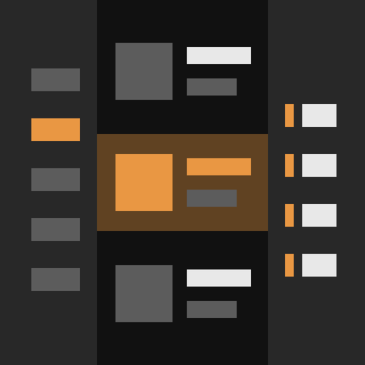

<p align="center"></p>

<h1 align="center">VTDownloader UI Refresh</h1>

<p align="center">A companion mod for <a href="https://github.com/IotaBread/VTDownloader">VTDownloader</a> that gives its download screen a new interface.<br>Fabric &amp; Quilt &nbsp;|&nbsp; 26.2</p>

---

Install it next to VTDownloader. It redraws the download screen in Vanilla Tweaks orange on black and adds search, resizable side panels, back and forward, and a choice of list or grid. VTDownloader still adds the button, loads the pack list, and downloads and shares your packs. Remove this mod and VTDownloader's own screen comes back.

## Install

Client-side only. Servers don't need it.

1. Install [Fabric Loader](https://fabricmc.net/use/) 0.19.3 or newer and [Fabric API](https://github.com/FabricMC/fabric-api).
2. Install VTDownloader for your Minecraft version. It's required.
3. Put this mod's jar for the same version in `mods`. Download it from [Releases](https://github.com/simply-sunny/vtdownloader-ui-refresh/releases).

| Minecraft | This mod | VTDownloader |
| --- | --- | --- |
| 26.2 | `vtdownloader-ui-refresh-26.2` | [2.6.0](https://github.com/IotaBread/VTDownloader/releases/tag/2.6.0) |

## Use

Open Options, then Resource Packs, and click Download VT Resource Pack.

| Do this | To |
| --- | --- |
| Click a category | Show its packs, then its subcategories |
| The arrow on a pack | Open its page: the preview, the whole description and what it conflicts with |
| Installed, at the bottom of the sidebar | Show the packs in the Vanilla Tweaks zips in your resource pack folder |
| Cmd/Ctrl+1 to 9, Ctrl+Tab, Ctrl+Shift+Tab | Open a category, or the next or previous sidebar row |
| Arrow keys, then Space or Enter | Move over the packs and select one. Shift selects a range. |
| Shift-click a pack | Select or deselect every pack from the last one clicked |
| Cmd/Ctrl+A | Select every pack in the list, or deselect them if they're all selected |
| Cmd/Ctrl+Shift+A | Deselect everything |
| Cmd/Ctrl+F | Search every category |
| Back and Forward, Cmd/Ctrl+[ and ], or the mouse's side buttons | Move through visited categories |
| List and grid buttons | Switch how packs are shown |
| Drag a panel's edge | Resize it |
| Drag a panel's edge to the window's edge | Hide it. An arrow brings it back. |

## Commands

They work on any server. Add `--reload` to any but `list` to apply it straight away: the zip turns on and the game reloads. Tab completes pack ids, and a chat line fits about 12 of them.

| Command | Does |
| --- | --- |
| `/vtd list` | Lists your Vanilla Tweaks zips, and which are on. |
| `/vtd list <zip>` | Lists the packs in a zip. |
| `/vtd create <zip> <packs>` | Makes a zip from the packs. |
| `/vtd edit <zip> add <packs>` | Adds packs to a zip. |
| `/vtd edit <zip> remove <packs>` | Removes packs from a zip. |
| `/vtd load <zip>` | Turns a zip on. |
| `/vtd unload <zip>` | Turns a zip off. |

## Configure

The screen remembers its layout in `config/vtd_ui_refresh/config.json`. Delete the file for the defaults.

## Develop

```
./gradlew buildAll
```

Jars are in `build/libs`. All code is in `src/main`. `GuiMixin` swaps VTDownloader's screen for `RefreshScreen` as it opens.

## Limits

- It uses VTDownloader's internals, so a new VTDownloader release can need a new build of this mod.
- Only the download screen changes. The button and pencil are VTDownloader's.

## License

MIT, see LICENSE. The screen is based on VTDownloader's code by IotaBread, also MIT, see LICENSE-VTDownloader. Packs are by [Vanilla Tweaks](https://vanillatweaks.net/).
